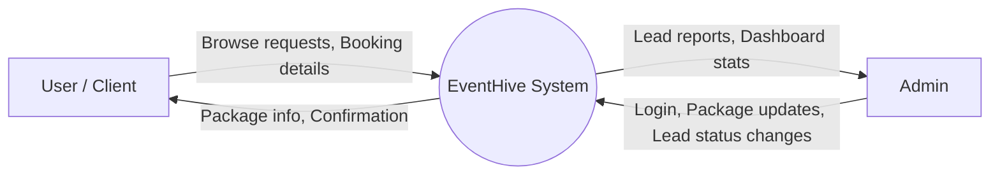
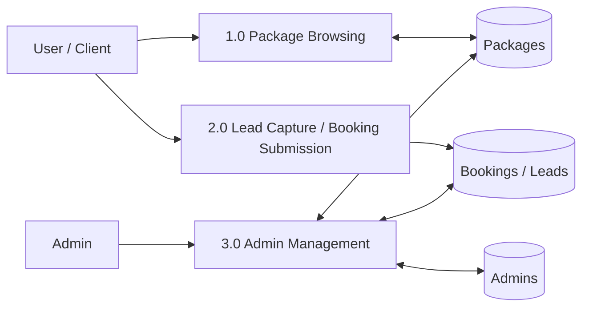
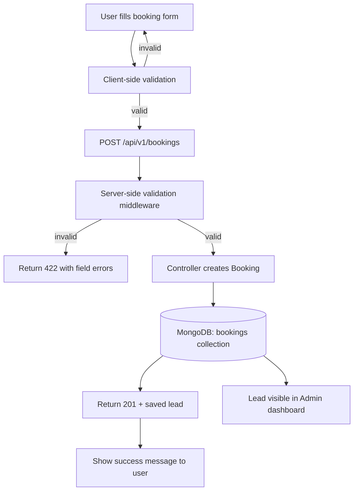

# EventHive — Event Booking Platform

> A full-stack **MERN** (MongoDB, Express.js, React, Node.js) web application that lets an event management startup **showcase event packages** and **capture bookings / leads** from clients.


---

## Table of Contents

1. [Problem Statement](#1-problem-statement)
2. [Project Overview](#2-project-overview)
3. [Objectives](#3-objectives)
4. [Scope](#4-scope)
5. [Tech Stack](#5-tech-stack)
6. [System Architecture](#6-system-architecture)
7. [Modules & Features](#7-modules--features)
8. [Project Structure](#8-project-structure)
9. [Database Design](#9-database-design)
10. [REST API Specification](#10-rest-api-specification)
11. [Frontend Pages & Routes](#11-frontend-pages--routes)
12. [Data Flow Diagrams](#12-data-flow-diagrams)
13. [Environment Variables](#13-environment-variables)
14. [Setup & Installation](#14-setup--installation)
15. [Seed Data](#15-seed-data)
16. [Coding Standards](#16-coding-standards)
17. [Git & GitHub Workflow](#17-git--github-workflow)
18. [Testing](#18-testing)
19. [Deployment](#19-deployment)
20. [Development Methodology](#20-development-methodology)
21. [Future Scope](#21-future-scope)
22. [Instructions for the AI Builder (Antigravity)](#22-instructions-for-the-ai-builder-antigravity)
23. [Definition of Done](#23-definition-of-done)
24. [References](#24-references)

---

## 1. Problem Statement

An event management startup wants a website to showcase event packages and capture bookings/leads from clients. The team must design and develop a **full-stack MERN application** — MongoDB, Express.js, React, Node.js — following **clean coding**, **REST API design**, and **Git/GitHub version control** practices.

## 2. Project Overview

In the modern event management industry, a strong digital presence is crucial for connecting with clients and organizing operations. **EventHive** is a full-stack web application designed to simplify event package browsing, booking inquiries, and lead management.

The platform is a centralized digital space that elegantly showcases a diverse range of event packages — from intimate **birthday parties** to grand **weddings** and **corporate seminars**. Beyond displaying services, EventHive captures client bookings and turns inquiries into valuable business leads.

### Key Highlights

- **Robust tech stack** — MERN gives an integrated, JavaScript-only environment for full-stack development.
- **Engaging user experience** — React, HTML5, CSS3, JavaScript and Bootstrap deliver a responsive, interactive, user-friendly interface across devices.
- **Automated lead capture** — Replaces manual tracking (phone calls, scattered emails) with dynamic forms that securely store client requirements in MongoDB.
- **Scalable architecture** — Strict clean-coding practices, REST API design principles, and Git/GitHub version control keep the platform maintainable and ready for growth.

### Why this project?

The goal is to bridge the gap between event organizers and potential clients. Traditional booking relies on manual tracking, phone calls and scattered emails, which leads to missed leads. EventHive automates this with a digital catalog and an automated lead-capture system, while giving the team hands-on experience in full-stack MERN development and modern version control.

## 3. Objectives

1. Develop a scalable web application that showcases diverse event packages interactively.
2. Design and implement **RESTful APIs** for handling booking inquiries and form submissions.
3. Capture and manage client leads effectively in a NoSQL database (**MongoDB**).
4. Apply industry-standard practices: clean coding, component-based UI design, and Git version control.

## 4. Scope

**In scope (initial release)**

- Responsive public frontend to browse event packages and view package details.
- Booking / inquiry form that submits to the backend.
- Backend that validates requests and stores them as **leads** in MongoDB.
- **Admin view** (login-protected) to track incoming bookings and manage event packages (add / update / delete).

**Out of scope for now (see [Future Scope](#21-future-scope))**

- Payment gateway, real-time chat, automated email confirmations.

## 5. Tech Stack

| Layer | Technology |
| --- | --- |
| Frontend | React.js (Vite), HTML5, CSS3, JavaScript (ES6+), Bootstrap 5 (+ React-Bootstrap) |
| Routing / HTTP | React Router, Axios |
| Backend | Node.js, Express.js |
| Database | MongoDB (Atlas cloud or local Community Server) with Mongoose ODM |
| Auth (admin) | JSON Web Tokens (JWT) + bcrypt password hashing |
| Validation | express-validator (or Joi) on the server; client-side form validation in React |
| API testing | Postman / Thunder Client |
| Version control | Git & GitHub |
| Editor | Visual Studio Code |

### Supporting libraries (backend)

`express`, `mongoose`, `cors`, `dotenv`, `bcryptjs`, `jsonwebtoken`, `express-validator`, `helmet`, `morgan`, `express-rate-limit`, `nodemon` (dev).

## 6. System Architecture

```
┌──────────────────────┐        HTTPS / JSON        ┌───────────────────────┐        Mongoose        ┌──────────────┐
│  React Frontend      │  ───────────────────────►  │  Express REST API     │  ───────────────────►  │   MongoDB    │
│  (Vite + Bootstrap)  │  ◄───────────────────────  │  (Node.js)            │  ◄───────────────────  │  (Atlas/Local)│
└──────────────────────┘                            └───────────────────────┘                        └──────────────┘
   Public site + Admin UI                           routes → controllers → services → models
```

Backend follows a layered pattern: **routes → controllers → (services) → models**, with middleware for auth, validation, and centralized error handling.

## 7. Modules & Features

The system has two primary modules.

### 7.1 User Module (public visitors / clients)

- Browse all available event packages (Birthday, Wedding, Corporate Seminar, etc.).
- Filter packages by category and search by name.
- View package details: description, price/starting price, inclusions, capacity, duration, images.
- Fill out the **booking / lead-generation form** with contact details and event requirements.
- Receive on-screen confirmation after a successful submission.
- Fully responsive on mobile, tablet and desktop.

### 7.2 Admin Module (event organizers)

- Secure **admin login** (JWT).
- Dashboard with summary counts (total leads, new leads, packages).
- View **all submitted booking requests (leads)** in a table, with search, filter by status, and pagination.
- Update a lead's **status** (`new` → `contacted` → `confirmed` / `cancelled`) and add internal notes.
- **Add, edit, and delete event packages.**

## 8. Project Structure

Use a monorepo with two top-level folders.

```
eventhive/
├── README.md
├── .gitignore
├── client/                      # React frontend (Vite)
│   ├── public/
│   ├── src/
│   │   ├── assets/              # images, icons
│   │   ├── components/          # reusable UI components
│   │   │   ├── layout/          # Navbar, Footer, Layout wrapper
│   │   │   ├── packages/        # PackageCard, PackageGrid, PackageFilters
│   │   │   ├── booking/         # BookingForm
│   │   │   ├── admin/           # LeadsTable, PackageForm, StatCard
│   │   │   └── common/          # Loader, ErrorMessage, ProtectedRoute, Pagination
│   │   ├── pages/               # Home, Packages, PackageDetails, Booking, About, Contact, NotFound
│   │   │   └── admin/           # AdminLogin, AdminDashboard, ManageLeads, ManagePackages
│   │   ├── context/             # AuthContext
│   │   ├── services/            # api.js (axios instance), packageService, bookingService, authService
│   │   ├── hooks/               # custom hooks (useFetch, useAuth)
│   │   ├── utils/               # helpers, validators, constants
│   │   ├── App.jsx
│   │   └── main.jsx
│   ├── .env.example
│   └── package.json
│
└── server/                      # Node + Express backend
    ├── src/
    │   ├── config/              # db.js, env config
    │   ├── models/              # Package.js, Booking.js, Admin.js
    │   ├── controllers/         # packageController.js, bookingController.js, authController.js
    │   ├── routes/              # packageRoutes.js, bookingRoutes.js, authRoutes.js
    │   ├── middleware/          # authMiddleware.js, validate.js, errorHandler.js, notFound.js
    │   ├── utils/               # generateToken.js, ApiError.js, asyncHandler.js
    │   ├── seed/                # seed.js (sample packages + admin)
    │   ├── app.js               # express app setup
    │   └── server.js            # entry point (connect DB + listen)
    ├── .env.example
    └── package.json
```

## 9. Database Design

Database name: `eventhive` (MongoDB). All schemas use Mongoose with `timestamps: true`.

### 9.1 `Package` (event package)

| Field | Type | Required | Notes |
| --- | --- | --- | --- |
| `title` | String | ✅ | e.g. "Dream Wedding Package" |
| `slug` | String | ✅ | unique, URL-friendly |
| `category` | String (enum) | ✅ | `birthday`, `wedding`, `corporate`, `anniversary`, `other` |
| `shortDescription` | String | ✅ | max ~160 chars, used on cards |
| `description` | String | ✅ | full details |
| `price` | Number | ✅ | starting price (INR) |
| `capacity` | Number | ❌ | approx. guests |
| `duration` | String | ❌ | e.g. "6 hours" |
| `inclusions` | [String] | ❌ | e.g. ["Decoration", "Catering", "DJ"] |
| `images` | [String] | ❌ | image URLs |
| `isFeatured` | Boolean | ❌ | default `false` |
| `isActive` | Boolean | ❌ | default `true` |

### 9.2 `Booking` (lead)

| Field | Type | Required | Notes |
| --- | --- | --- | --- |
| `name` | String | ✅ | client full name |
| `email` | String | ✅ | validated format |
| `phone` | String | ✅ | validated (10-digit Indian mobile, flexible) |
| `package` | ObjectId → `Package` | ❌ | selected package (optional for general inquiries) |
| `eventType` | String | ✅ | birthday / wedding / corporate / other |
| `eventDate` | Date | ✅ | must be a future date |
| `guestCount` | Number | ✅ | min 1 |
| `venue` | String | ❌ | city / venue preference |
| `budget` | Number | ❌ | approx. budget |
| `message` | String | ❌ | additional requirements |
| `status` | String (enum) | ✅ | `new` (default), `contacted`, `confirmed`, `cancelled` |
| `adminNotes` | String | ❌ | internal notes |

### 9.3 `Admin`

| Field | Type | Required | Notes |
| --- | --- | --- | --- |
| `name` | String | ✅ | |
| `email` | String | ✅ | unique |
| `password` | String | ✅ | **bcrypt-hashed**, `select: false` |
| `role` | String | ❌ | default `admin` |

## 10. REST API Specification

**Base URL:** `/api/v1`
**Format:** JSON. Responses follow a consistent shape:

```json
{ "success": true, "data": { }, "message": "Optional message" }
```

Errors:

```json
{ "success": false, "message": "Validation failed", "errors": [ { "field": "email", "msg": "Invalid email" } ] }
```

### 10.1 Auth

| Method | Endpoint | Access | Description |
| --- | --- | --- | --- |
| POST | `/auth/login` | Public | Admin login → returns JWT |
| GET | `/auth/me` | Admin | Get current admin profile |

### 10.2 Packages

| Method | Endpoint | Access | Description |
| --- | --- | --- | --- |
| GET | `/packages` | Public | List active packages. Query: `category`, `search`, `featured`, `page`, `limit`, `sort` |
| GET | `/packages/:id` | Public | Get single package (by id or slug) |
| POST | `/packages` | Admin | Create package |
| PUT | `/packages/:id` | Admin | Update package |
| DELETE | `/packages/:id` | Admin | Delete (or soft-delete) package |

### 10.3 Bookings / Leads

| Method | Endpoint | Access | Description |
| --- | --- | --- | --- |
| POST | `/bookings` | Public | Submit a booking inquiry (creates a lead) |
| GET | `/bookings` | Admin | List all leads. Query: `status`, `search`, `page`, `limit`, `sort` |
| GET | `/bookings/:id` | Admin | Get a single lead |
| PATCH | `/bookings/:id` | Admin | Update status / admin notes |
| DELETE | `/bookings/:id` | Admin | Delete a lead |
| GET | `/bookings/stats/summary` | Admin | Counts per status for dashboard |

### 10.4 Health

| Method | Endpoint | Access | Description |
| --- | --- | --- | --- |
| GET | `/health` | Public | API health check |

### HTTP status codes used

`200 OK`, `201 Created`, `400 Bad Request`, `401 Unauthorized`, `403 Forbidden`, `404 Not Found`, `409 Conflict`, `422 Unprocessable Entity`, `429 Too Many Requests`, `500 Internal Server Error`.

### Sample request — create a booking

```http
POST /api/v1/bookings
Content-Type: application/json

{
  "name": "Riya Verma",
  "email": "riya@example.com",
  "phone": "9876543210",
  "package": "665f1c...",
  "eventType": "wedding",
  "eventDate": "2026-12-12",
  "guestCount": 250,
  "venue": "Mathura",
  "budget": 800000,
  "message": "Need floral decoration and live music."
}
```

## 11. Frontend Pages & Routes

### Public

| Route | Page | Description |
| --- | --- | --- |
| `/` | Home | Hero section, featured packages, how-it-works, testimonials (static), CTA |
| `/packages` | Packages | Grid of all packages with category filter + search |
| `/packages/:id` | Package Details | Full details + "Book this package" button |
| `/book` | Booking | Booking/lead form (pre-fills package if coming from details page) |
| `/about` | About | About the startup |
| `/contact` | Contact | Contact info |
| `*` | Not Found | 404 page |

### Admin (protected by `ProtectedRoute`)

| Route | Page | Description |
| --- | --- | --- |
| `/admin/login` | Admin Login | Email + password form |
| `/admin` | Dashboard | Stats cards + recent leads |
| `/admin/leads` | Manage Leads | Table, filters, status update, notes, delete |
| `/admin/packages` | Manage Packages | List with add / edit / delete |
| `/admin/packages/new`, `/admin/packages/:id/edit` | Package Form | Create / update package |

### UI / UX requirements

- Bootstrap grid for responsiveness (mobile-first); clean, modern look with a consistent colour palette and typography.
- Loading spinners, empty states, and friendly error messages for every data-fetching view.
- Client-side validation on the booking form with inline error messages; success toast/alert on submit.
- Accessible markup (labels, alt text, keyboard-friendly navigation).

## 12. Data Flow Diagrams

### Level 0 — Context Diagram

External entities (**User/Client** and **Admin**) interact with the EventHive system as a whole. The user provides booking details; the admin receives lead reports.



### Level 1 — Primary Processes

Breaks the system into: **Package Browsing**, **Lead Capture / Booking Submission**, and **Data Storage**, showing data flowing from the UI to the API server.



### Level 2 — Booking Submission (detailed)

The booking submission process validates user input, sends a `POST` request to the API, and inserts a new lead document into MongoDB.



## 13. Environment Variables

### `server/.env.example`

```env
NODE_ENV=development
PORT=5000
MONGO_URI=mongodb://127.0.0.1:27017/eventhive
# For Atlas: mongodb+srv://<user>:<password>@<cluster>.mongodb.net/eventhive
JWT_SECRET=replace_with_a_long_random_string
JWT_EXPIRES_IN=7d
CLIENT_URL=http://localhost:5173

# Used by the seed script
ADMIN_NAME=EventHive Admin
ADMIN_EMAIL=admin@eventhive.com
ADMIN_PASSWORD=Admin@12345
```

### `client/.env.example`

```env
VITE_API_BASE_URL=http://localhost:5000/api/v1
```

> **Never commit real `.env` files.** Only commit the `.env.example` templates.

## 14. Setup & Installation

### Prerequisites

- Windows 10/11 or macOS
- [Node.js](https://nodejs.org/) (LTS, v18+) and npm
- MongoDB Atlas account **or** MongoDB Community Server (local)
- Git & GitHub account
- VS Code, Postman / Thunder Client
- Hardware: Intel Core i3/i5 (or AMD equivalent), min. 4 GB RAM, min. 1 GB storage, stable internet

### Steps

```bash
# 1. Clone the repository
git clone https://github.com/<your-username>/eventhive.git
cd eventhive

# 2. Backend
cd server
cp .env.example .env        # then edit the values
npm install
npm run seed                # optional: loads sample packages + admin user
npm run dev                 # starts API on http://localhost:5000

# 3. Frontend (in a new terminal)
cd client
cp .env.example .env
npm install
npm run dev                 # starts app on http://localhost:5173
```

### NPM scripts

**server/package.json**

| Script | Purpose |
| --- | --- |
| `npm run dev` | Start with nodemon |
| `npm start` | Start in production mode |
| `npm run seed` | Seed database |

**client/package.json**

| Script | Purpose |
| --- | --- |
| `npm run dev` | Vite dev server |
| `npm run build` | Production build |
| `npm run preview` | Preview production build |

## 15. Seed Data

The seed script (`server/src/seed/seed.js`) should:

1. Clear existing `packages` and `admins` (only when run explicitly).
2. Create **one admin** from the `ADMIN_*` env variables (password hashed).
3. Insert **at least 8 sample packages** across categories, for example:
   - Birthday: "Kids Birthday Bash", "Sweet Sixteen Celebration"
   - Wedding: "Royal Wedding Package", "Intimate Wedding Package", "Engagement & Ring Ceremony"
   - Corporate: "Corporate Seminar Package", "Product Launch Package", "Team Offsite & Annual Day"
4. Each package should include realistic `price`, `capacity`, `duration`, `inclusions`, and placeholder image URLs (local assets or royalty-free image links).

## 16. Coding Standards

**General**

- Meaningful, descriptive names; small single-purpose functions; no dead code or stray `console.log`s.
- Use ES6+ (`const`/`let`, arrow functions, async/await, destructuring, modules).
- Follow **DRY** and **separation of concerns**.
- Use **ESLint + Prettier** with a shared config (2-space indent, single quotes, semicolons).
- Comment *why*, not *what*; add JSDoc to non-obvious functions.

**Backend**

- Layered architecture: routes → controllers → models; keep controllers thin.
- Wrap async handlers with `asyncHandler`; throw `ApiError`; handle everything in a **central error-handling middleware**.
- Validate all incoming data (never trust the client); sanitize inputs.
- Use `helmet`, `cors` (restricted to `CLIENT_URL`), and `express-rate-limit` (especially on `/auth/login` and `POST /bookings`).
- Never return password hashes; never hard-code secrets.
- Use proper REST semantics: nouns for resources, correct HTTP verbs and status codes, versioned base path (`/api/v1`), pagination for list endpoints.

**Frontend**

- Functional components with hooks only; one component per file; PascalCase component names.
- Keep API calls in `services/`, not inside components.
- Reusable, presentational components in `components/`; page-level logic in `pages/`.
- Handle loading, error and empty states everywhere.
- Store the admin JWT securely (memory/`localStorage` with an Axios interceptor attaching `Authorization: Bearer <token>`); auto-logout on 401.

## 17. Git & GitHub Workflow

- **Branching:** `main` (stable/deployable) ← `develop` (integration) ← feature branches.
  - Naming: `feature/<short-name>`, `fix/<short-name>`, `docs/<short-name>` (e.g. `feature/booking-form`).
- **Commits:** small, frequent, meaningful, following **Conventional Commits**:
  - `feat: add booking form validation`
  - `fix: correct package price filter`
  - `docs: update README setup steps`
  - `refactor:`, `style:`, `test:`, `chore:`
- **Pull Requests:** every feature merges to `develop` through a PR with a short description and at least one teammate review.
- **Never commit:** `node_modules/`, `.env`, build output, OS/editor junk — maintain a proper `.gitignore`.
- Every team member should have commits and PRs in the repository history.
- Tag a release (e.g. `v1.0.0`) on `main` at final submission.

## 18. Testing

| Type | Tooling | What to cover |
| --- | --- | --- |
| REST API testing | **Postman** (export collection to `/docs/postman/`) | All endpoints: success cases, validation errors, auth failures |
| Manual UI testing | Browser | Booking form validation, filters, admin CRUD flows |
| Cross-browser / responsive | Chrome, Edge, Firefox; mobile/tablet/desktop viewports | Layout and usability |

Optional (bonus): Jest + Supertest for backend endpoints, React Testing Library for key components.

### Manual test checklist

- [ ] Packages list loads, category filter and search work
- [ ] Package details page loads; "Book this package" pre-fills the form
- [ ] Booking form rejects invalid email/phone/past date and shows inline errors
- [ ] Valid booking is saved and visible in admin leads table
- [ ] Admin login works; wrong credentials are rejected; protected routes redirect when logged out
- [ ] Admin can change lead status, add notes, delete a lead
- [ ] Admin can add / edit / delete a package and see it reflected on the public site
- [ ] Site is usable at 360px, 768px and 1280px widths

## 19. Deployment

| Part | Suggested platform |
| --- | --- |
| Database | MongoDB Atlas (free tier) |
| Backend API | Render / Railway |
| Frontend | Vercel / Netlify |

- Set all environment variables in each platform's dashboard.
- Set `CLIENT_URL` on the backend to the deployed frontend URL (CORS) and `VITE_API_BASE_URL` on the frontend to the deployed API URL.
- Add the live URLs here once deployed:
  - **Live site:** _TBD_
  - **API:** _TBD_

## 20. Development Methodology

The team follows **Agile**, building step by step:

1. **Planning & Design** — layouts for the event catalog and booking forms.
2. **Backend Setup** — Node.js + Express server; MongoDB for event and booking data.
3. **Frontend Setup** — interactive React screens styled to look clean and modern.
4. **Integration & Testing** — connect React to Express so forms and data work smoothly together.
5. **Version Control & Deployment** — manage code with Git/GitHub and publish the final app to the web.

## 21. Future Scope

- Integrated payment gateway (advance booking payments)
- Real-time chat support for clients
- Automated email confirmations / notifications to client and admin
- Calendar availability and date-blocking
- Reviews & ratings, image gallery uploads (Cloudinary)
- Multi-admin roles and analytics dashboard

## 22. Instructions for the AI Builder (Antigravity)

Build the complete project described in this README. Follow these rules:

1. **Scaffold the monorepo** exactly as in [Project Structure](#8-project-structure) (`client/` with Vite + React, `server/` with Express).
2. **Implement the backend first**: models → routes → controllers → middleware → error handling → seed script. Make sure every endpoint in [REST API Specification](#10-rest-api-specification) works and returns the standard response shape.
3. **Then build the frontend**: all pages/routes in [Frontend Pages & Routes](#11-frontend-pages--routes), using **Bootstrap 5** for styling and Axios services for API calls.
4. **Use the stack exactly as specified** (MERN, Mongoose, JWT). Do not introduce TypeScript, Next.js, or a different database.
5. **Security basics are mandatory**: hashed passwords, JWT-protected admin routes, input validation, CORS restricted to the client URL, rate limiting, no secrets committed.
6. **Provide `.env.example` files**, a root `.gitignore`, and working `npm` scripts so the project runs with the commands in [Setup & Installation](#14-setup--installation).
7. **Seed realistic data** (see [Seed Data](#15-seed-data)) so the site looks complete on first run.
8. **Design quality matters**: modern, clean, responsive UI with a cohesive palette, a strong hero section, card-based package grid, and polished forms. Handle loading/error/empty states.
9. **Keep the code clean**: follow [Coding Standards](#16-coding-standards); no unused code; comment where needed.
10. **Commit style**: if you create commits, use Conventional Commit messages.
11. When finished, **update this README** with the final run instructions, default admin credentials (from seed), and any deviations from this spec.

## 23. Definition of Done

- [ ] `npm run dev` works in both `server/` and `client/` with only the `.env` files configured
- [ ] Public users can browse, filter, and view packages
- [ ] Public users can submit a booking and it is stored as a lead in MongoDB
- [ ] Admin can log in, view/manage leads, and add/edit/delete packages
- [ ] All REST endpoints behave per the spec with correct status codes and validation
- [ ] UI is responsive across mobile, tablet and desktop
- [ ] Code is clean, structured, and free of hard-coded secrets
- [ ] Repository has meaningful commit history, PRs, and a proper `.gitignore`
- [ ] README is up to date and the Postman collection is included

## 24. References

- Node.js Documentation — https://nodejs.org/api/
- React Documentation — https://react.dev/
- Express.js Documentation — https://expressjs.com/
- MongoDB Documentation — https://www.mongodb.com/docs/manual/
- GitHub Documentation — https://docs.github.com/en

---

<p align="center">Made with ❤️ by Team EventHive — GLA University</p>